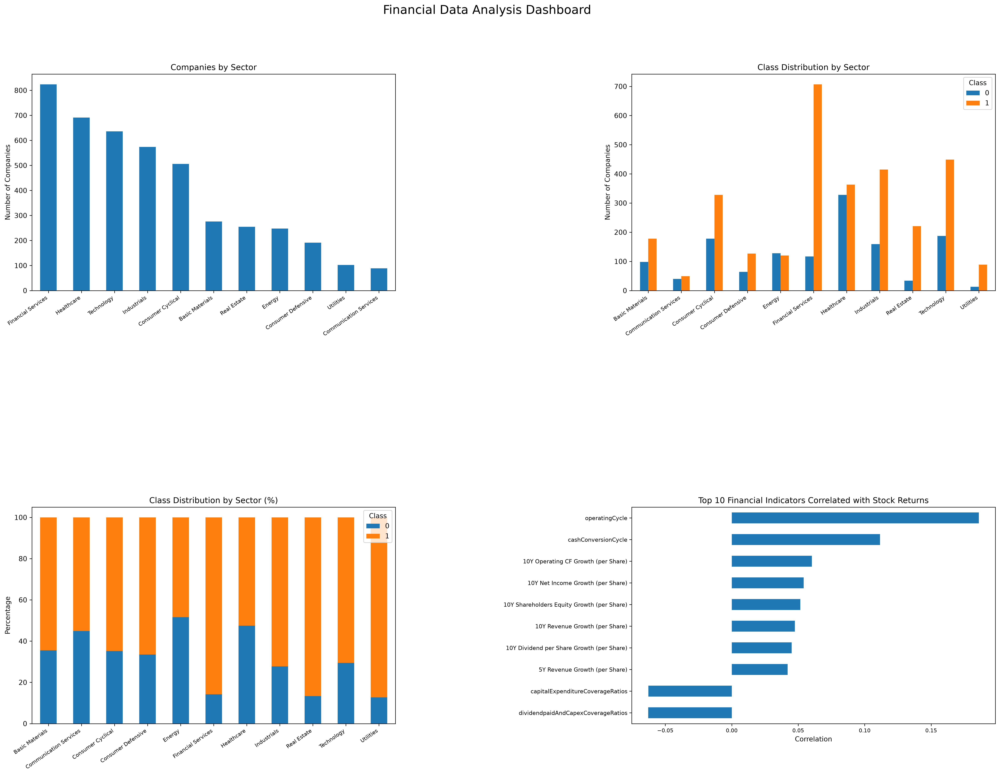

# Financial Performance Analysis and Stock Return Classification

## 1. Project Overview

This project analyzes financial data of US companies from 2014 to 2018.

The main goals are:
- Explore financial indicators.
- Find relationships between financial features and stock returns.
- Build Machine Learning models to classify stock performance.
- Compare model results.

## 2. Dataset

**Source:** [Kaggle – 200+ Financial Indicators of US Stocks (2014–2018)](https://www.kaggle.com/datasets/cnic92/200-financial-indicators-of-us-stocks-20142018)

The dataset contains financial indicators of US companies from different sectors.

## 3. Tools and Libraries

- Python
- Pandas
- NumPy
- Matplotlib
- Scikit-learn

## 4. Exploratory Data Analysis (EDA)

The analysis includes:
- Company distribution by sector.
- Stock return class distribution.
- Class distribution by sector.
- Correlation analysis.
 ### EDA Dashboard

 

 ## 5. Machine Learning

Two machine learning models were developed to classify companies based on their financial indicators:

- Logistic Regression
- Random Forest Classifier

The dataset was divided into training and testing sets. Missing values were handled using imputation, numerical features were scaled, and categorical features were encoded.

## 6. Model Evaluation

The models were evaluated using Accuracy, Precision, Recall, and F1-score.

| Model | Accuracy | Weighted F1 |
|---|---:|---:|
| Logistic Regression | 66.78% | 68.06% |
| Random Forest | 72.92% | 73.58% |

The Random Forest model achieved better results than Logistic Regression on the test set.

However, its accuracy was only slightly higher than the majority-class baseline of 69.40%.

## 7. Conclusion

This project helped me practice data analysis and data visualization.

