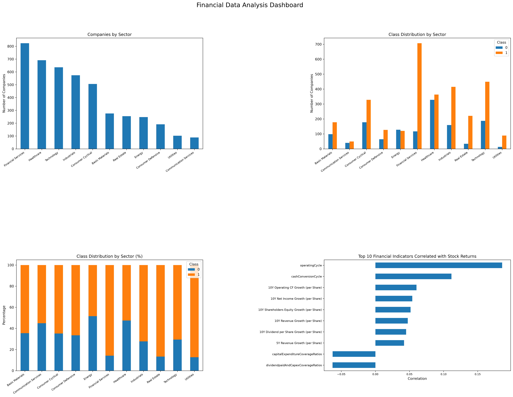
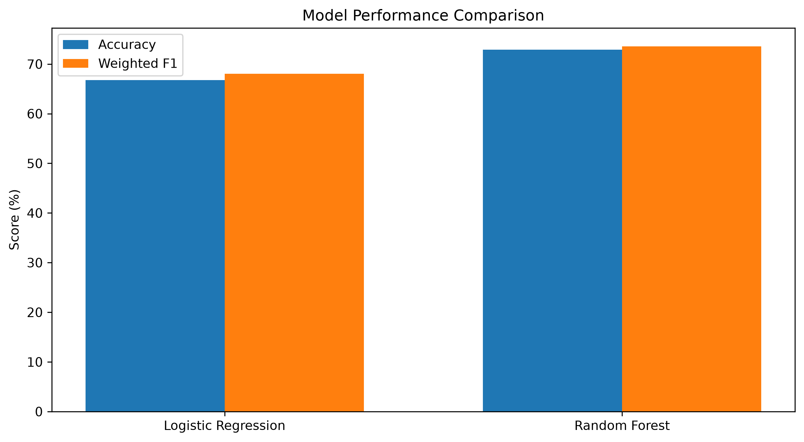

# Financial Performance Analysis and Stock Return Classification

## 1. Project Overview

This project analyzes financial data of US companies from 2014 to 2018.

The main goals are:
- Explore financial indicators.
- Find relationships between financial features and stock returns.
- Build Machine Learning models to classify stock performance.
- Compare model results.

## 2. Dataset

**Source:** [Kaggle – 200+ Financial Indicators of US Stocks (2014–2018)](https://www.kaggle.com/datasets/cnic92/200-financial-indicators-of-us-stocks-20142018)

The dataset contains financial indicators of US companies from different sectors.

## 3. Tools and Libraries

- Python
- Pandas
- NumPy
- Matplotlib
- Scikit-learn

## 4. Exploratory Data Analysis (EDA)

The analysis includes:
- Company distribution by sector.
- Stock return class distribution.
- Class distribution by sector.
- Correlation analysis.
 ### EDA Dashboard

 

## 5. Machine Learning

Two classification models were developed:

- Logistic Regression
- Random Forest Classifier

The models were evaluated using:
- Accuracy
- Precision
- Recall
- F1-score
- Confusion Matrix

## 6. Model Results

Results from the random train-test split:

| Model | Accuracy | Weighted F1 |
|---|---:|---:|
| Logistic Regression | 66.78% | 68.06% |
| Random Forest | 72.92% | 73.58% |
### Model Performance Comparison

An additional experiment trained the models on data from 2014–2017 and tested them on 2018 data.

Both models performed below the majority-class baseline in this experiment.

## 7. Conclusion

This project helped me practice data analysis, data visualization, data preprocessing, and Machine Learning.

The experiments also showed that good results on a random split do not always mean that a model can generalize well to future data.
